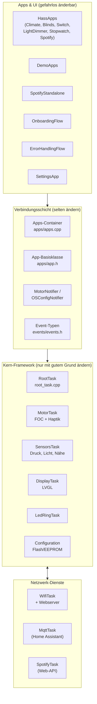

# Architektur der SmartKnob-Firmware

Diese Doku erklärt, wie die Firmware aufgebaut ist, was welches Modul tut und wann was aufgerufen wird. Das Ziel ist eine klare Trennung:

- **Kern-Framework**: Motor/FOC, virtuelle Haptik, Eingaben (Drehen, Drücken, Sensoren), Tasks und Ablaufsteuerung. Das sollte man nur mit gutem Grund anfassen.
- **Apps und UI**: Bildschirme, Menü, Home-Assistant-Apps, Spotify, Demo. Hier kann man gefahrlos ändern und erweitern.

> Stand: Code auf `main` (Commit `afd6632`, „Spotify App“). Pfade beziehen sich auf `firmware/src/`.

## Inhalt

| Seite | Worum es geht |
|---|---|
| [1. Kern-Framework](architektur/01-kern-framework.md) | Tasks, Motor & Haptik, Eingaben, RootTask, Event-Bus, Konfiguration |
| [2. Abläufe](architektur/02-ablaeufe.md) | Was passiert wann: Boot, Drehen, Drücken, HA-Sync, Spotify, Moduswechsel (mit Diagrammen) |
| [3. Apps und UI](architektur/03-apps-und-ui.md) | OS-Modi, `App`-Basisklasse, Menü, Seiten, HA-, Demo- und Spotify-Apps |
| [4. Anleitung: App/UI ändern oder hinzufügen](architektur/04-anleitung-app-hinzufuegen.md) | Schritt für Schritt mit Beispielcode, ohne den Kern anzufassen |

## Das Bild in einem Satz

Rund zehn FreeRTOS-Tasks laufen parallel. Die **MotorTask** regelt den Motor und meldet alle ~5 ms die Knopfposition. Die **RootTask** ist die Zentrale: Sie sammelt Position, Sensordaten und Netzwerk-Events ein, gibt sie an die gerade aktive **App** weiter und schickt deren Wünsche (neue Haptik, Zustand an Home Assistant) zurück an Motor und Netzwerk. Die **DisplayTask** zeichnet nur noch das, was die Apps vorher in LVGL-Objekte geschrieben haben.

## Schichtenmodell

## Modulkarte: was liegt wo?

| Pfad | Schicht | Aufgabe |
|---|---|---|
| `main.cpp` | Kern | Erzeugt alle Tasks als statische Objekte, verdrahtet Queues, startet alles in `setup()`. |
| `task.h` | Kern | Basisklasse `Task<T>` für FreeRTOS-Tasks (CRTP). `begin()` startet `run()` auf festem Kern. |
| `root_task.*` | Kern | Zentrale Schleife (10 ms): Events verteilen, aktive App updaten, Navigation, Helligkeit, LED-Ring. |
| `motor_foc/` | Kern | `MotorTask`: SimpleFOC, Detent-/Endanschlag-Regelung, Haptik-Klick, Kalibrierung. Encoder-Treiber (MT6701, TLV, MAQ430). |
| `motors/` | Kern | PID- und Spannungsgrenzen pro Motortyp (`FOC_PID_P` usw.). |
| `sensors/` | Kern | `SensorsTask`: Dehnungsmessstreifen (HX711) → virtueller Taster, Lichtsensor (VEML7700), Näherung (VL53L0X), Chiptemperatur. |
| `display_task.*`, `display/` | Kern | LVGL-Init, Display-Treiber (LovyanGFX), Hintergrundbeleuchtung, `lv_task_handler()`-Schleife. |
| `led_ring/` | Kern | `LedRingTask`: Effekte für die 72 LEDs (FastLED). |
| `configuration.*` | Kern | Persistente Daten: Motorkalibrierung, Settings, Spotify (FFat, Protobuf) sowie WLAN, MQTT, OS-Modus (EEPROM). |
| `proto/` | Kern | nanopb-Protokoll zum Konfigurator am USB-Port, erzeugte Strukturen (`PB_SmartKnobConfig` usw.). |
| `error_handling_flow/reset_task.*` | Kern | `ResetTask`: Reset-Taster überwachen, Soft-/Hard-Reset. |
| `app_config.h` | Verbindung | Gemeinsame Zustandsstrukturen: `AppState`, `SensorsState`, `EntityStateUpdate`, Taster-Codes. |
| `events/events.h` | Verbindung | Alle Event-Typen (`EventType`) und der Event-Container `WiFiEvent` (trotz Name: generischer Event). |
| `navigation/navigation.h` | Verbindung | `NavigationEvent`: `SHORT` / `LONG`. |
| `notify/` | Verbindung | Notifier: Thread-sichere Briefkästen (Queues), z. B. „bitte Motor-Config anwenden“, „bitte OS-Modus wechseln“. |
| `apps/app.*`, `apps/apps.*` | Verbindung | `App`-Basisklasse und der Container, der Apps lädt, umschaltet und Updates verteilt. |
| `apps/*/` | Apps | Die einzelnen Apps (Climate, Blinds, Switch, LightDimmer, Stopwatch, Spotify, Settings). |
| `apps/hass_apps.*`, `apps/demo_apps.*`, `apps/spotify_standalone.*` | Apps | Je ein App-Satz pro Betriebsmodus. |
| `onboarding_flow/` | Apps | Ersteinrichtung (WLAN, HA, Spotify, Demo). |
| `error_handling_flow/` (ohne `reset_task`) | Apps | Fehlerbildschirme für WLAN/MQTT. |
| `network/` | Netzwerk | `WifiTask` (inkl. Webserver für Setup und OTA), `MqttTask` (HA), `spotify/` (API-Client und Task). |
| `assets/` | Apps | Schriften und Icons als C-Arrays für LVGL. |
| `../data/setup/` | Apps | Kompilierte Setup-Webseite (Quelle: `software/web-preact/`). |
| `../not_reimplemented/` | – | Alte Apps, die nicht mehr kompiliert werden. |

## Faustregeln für Änderungen

**Gefahrlos** (nur Apps/UI betroffen):

- Layout, Farben, Texte, Icons einer App ändern.
- Haptik einer App ändern (Rastung, Anzahl Positionen, Stärke): das ist nur die `motor_config` der App, siehe [Anleitung](architektur/04-anleitung-app-hinzufuegen.md#43-haptik-einer-app-anpassen).
- Neue App hinzufügen (neue Klasse plus ein Eintrag in `Apps::loadApp`).
- Demo-Inhalte ändern (JSON in `DemoApps`).
- Seiten in den Settings ergänzen.

**Vorsicht, Verbindungsschicht** (betrifft alle Apps):

- `App`, `Apps`, `AppState`, `EntityStateUpdate`, `events.h`.

**Kern** (Testen mit echter Hardware nötig):

- `motor_task.cpp`, `sensors_task.cpp`, `root_task.cpp`, `main.cpp`, Task-Prioritäten, Stack-Größen, Kerne.
- Einen neuen Betriebsmodus (`OSMode`) einführen. Das braucht Änderungen in `RootTask` und `DisplayTask`, siehe [Apps und UI](architektur/03-apps-und-ui.md#31-betriebsmodi-osmode).

## Glossar

| Begriff | Bedeutung |
|---|---|
| **Detent** | Virtuelle Rastung. Der Motor zieht den Knopf zur nächsten Rastposition. |
| **Position / Sub-Position** | Ganzzahlige Rastposition und der Bruchteil zwischen zwei Rastungen (`sub_position_unit`). |
| **`PB_SmartKnobConfig`** | Haptik-Profil: Anzahl Positionen, Breite, Stärke usw. Jede App hat eins. |
| **`PB_SmartKnobState`** | Was der Motor meldet: aktuelle Position, Sub-Position und die aktive Config. |
| **Virtueller Taster** | Drücken wird über einen Dehnungsmessstreifen erkannt, nicht über einen echten Schalter. Der Motor spielt dazu einen „Klick“. |
| **OS-Modus** | Betriebsart der Firmware: `ONBOARDING`, `DEMO`, `HASS`, `SPOTIFY`. |
| **Shared Events Queue** | Der zentrale Event-Bus. Alle Dienste schreiben `WiFiEvent`s hinein, die RootTask liest sie. |
| **App-Slug** | Kennung des App-Typs (z. B. `"switch"`), über die Home Assistant festlegt, welche App-Klasse geladen wird. |
