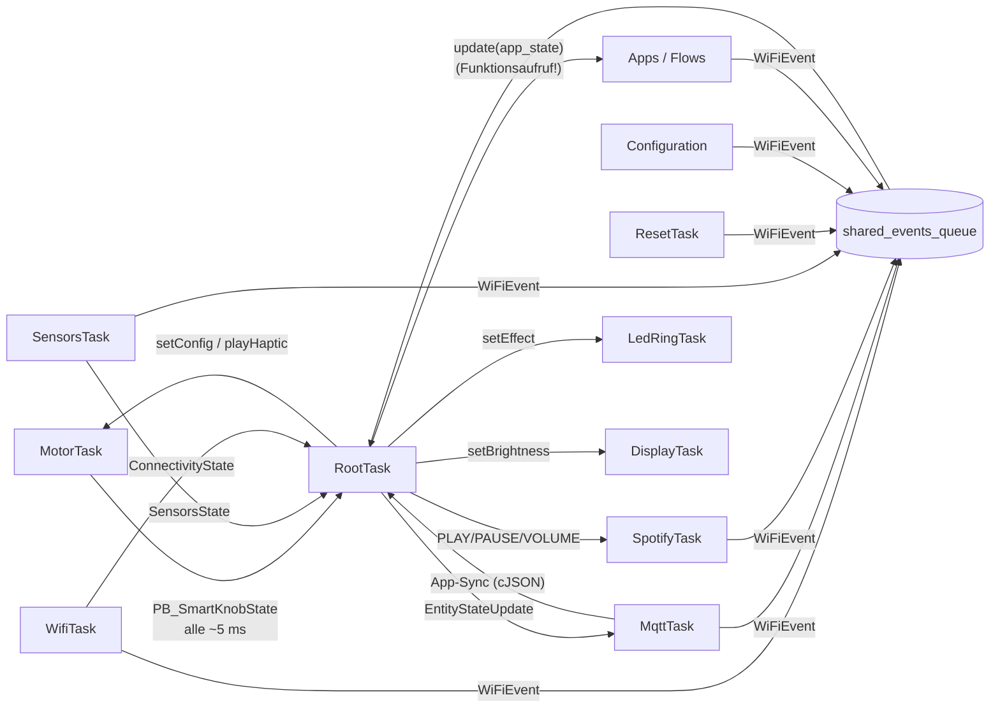
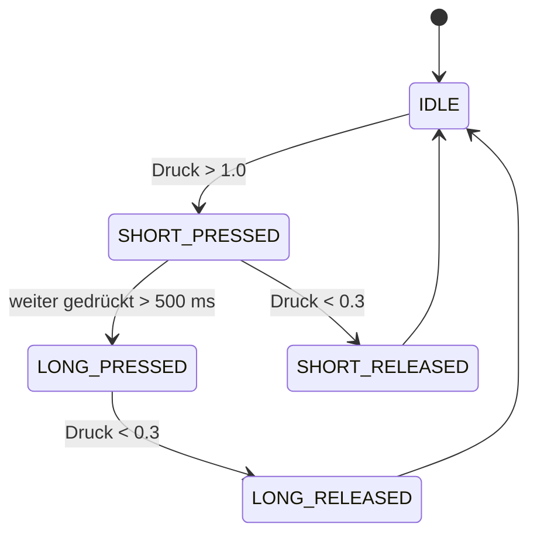
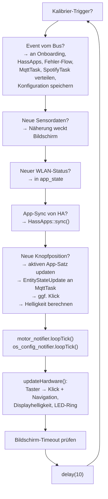

# 1. Kern-Framework

[← Übersicht](../ARCHITEKTUR.md) · [2. Abläufe →](02-ablaeufe.md)

Der Kern ist alles, was den Knopf zu einem Knopf macht: Motor und Haptik, Erkennung von Drehen und Drücken, die Task-Struktur und die zentrale Ablaufsteuerung. Apps bauen darauf auf, sollten den Kern aber nicht verändern müssen.

## 1.1 Tasks im Überblick

Alle Tasks erben von `Task<T>` (`task.h`). Der Konstruktor legt Name, Stack, Priorität und CPU-Kern fest, `begin()` startet `run()` per `xTaskCreatePinnedToCore`. Die Objekte werden in `main.cpp` statisch angelegt.

| Task | Datei | Kern | Prio | Stack | Aufgabe |
|---|---|---|---|---|---|
| **RootTask** | `root_task.cpp` | 0 | `ESP_TASK_MAIN_PRIO` | 18 KB | Zentrale Schleife, verteilt alles (siehe [1.5](#15-roottask-die-zentrale)) |
| **Display** | `display_task.cpp` | 0 | 2 | 5 KB | LVGL initialisieren, `lv_task_handler()` alle 5 ms |
| **Motor** | `motor_foc/motor_task.cpp` | 1 | 1 | 6 KB | FOC-Regelung, Haptik, Position melden (siehe [1.2](#12-motortask-motor-und-virtuelle-haptik)) |
| **Sensors** | `sensors/sensors_task.cpp` | 1 | 1 | 8 KB | Druck, Licht, Nähe, Temperatur (siehe [1.3](#13-eingaben-drehen-drücken-sensoren)) |
| **wifi** | `network/wifi_task.cpp` | 1 | 1 | 10 KB | WLAN (STA/AP), Setup-Webserver, OTA, besitzt den Event-Bus |
| **mqtt** | `network/mqtt_task.cpp` | 1 | 1 | 9 KB | Verbindung zu Home Assistant |
| **spotify** | `network/spotify/spotify_task.cpp` | 1 | 1 | 10 KB | Spotify-Web-API (läuft nur, wenn ein Token vorhanden ist) |
| **Led_Ring** | `led_ring/led_ring_task.cpp` | 1 | 0 | 3 KB | LED-Effekte |
| **ResetTask** | `error_handling_flow/reset_task.cpp` | 1 | 0 | 8 KB | Reset-Taster, Soft-/Hard-Reset |
| Logging-Adapter | `main.cpp` (Bibliothek `logging`) | 1 | 0 | 10 KB | Serielle Logausgabe, nur mit `ENABLE_LOGGING` |

Welche Tasks überhaupt gebaut werden, steuern Build-Flags in `platformio.ini`: `SK_DISPLAY`, `SK_LEDS`, `SK_WIFI`, `SK_MQTT`, `SK_STRAIN`, `SK_ALS` (Lichtsensor), `SK_PROXIMITY`. Hardware-Varianten ebenfalls: `SENSOR_MT6701` (Encoder), `MOTOR_WANZHIDA_ONCE_TOP` (PID-Werte), `SK_INVERT_ROTATION`.

### Wie Tasks miteinander reden

Tasks rufen sich nie direkt in den Code des anderen hinein, sondern schicken Daten über **FreeRTOS-Queues**. Es gibt drei Muster:

1. **Zustands-Queue (Länge 1, `xQueueOverwrite`)**: immer nur der neueste Wert zählt. Beispiel: Motor → RootTask (Knopfposition), WifiTask → RootTask (Verbindungsstatus).
2. **Befehls-Queue**: Aufträge, die der Reihe nach abgearbeitet werden. Beispiel: `MotorTask::setConfig()`, `playHaptic()`, `runCalibration()` legen je ein `Command` in die Queue der MotorTask.
3. **Event-Bus (`shared_events_queue`)**: ein gemeinsamer Briefkasten für `WiFiEvent`s (der Name ist historisch, es sind generische Events). Er gehört der WifiTask (`getWiFiEventsQueue()`), die RootTask verteilt ihn in `setup` an alle anderen. Schreiben dürfen alle, lesen tut nur die RootTask.

Wichtig: Die Apps sind **keine eigene Task**. Ihre Methoden (`updateStateFromKnob` usw.) werden direkt aus der RootTask aufgerufen. Sie schreiben dabei in LVGL-Objekte, die die DisplayTask anschließend zeichnet. Deshalb nimmt jede App vor LVGL-Zugriffen den gemeinsamen Bildschirm-Mutex (`SemaphoreGuard lock(mutex_);`).

## 1.2 MotorTask: Motor und virtuelle Haptik

Datei: `motor_foc/motor_task.cpp`. Das ist das Herz des Knopfes.

### Was sie tut

1. **Init** (`run()` Anfang): 6-PWM-Treiber, Encoder (MT6701 per SPI), SimpleFOC im **Drehmoment-Modus**. Kalibrierdaten (Polpaare, Richtung, elektrischer Nullpunkt) kommen aus `Configuration`. Ohne Kalibrierung werden alle Befehle außer `CALIBRATE` ignoriert und der Motor bleibt aus.
2. **Endlosschleife** (etwa 1 kHz, `delay(1)`):
   - `motor.loopFOC()` (Kommutierung).
   - Einen Befehl aus der Queue holen: `CONFIG`, `HAPTIC` oder `CALIBRATE`.
   - Haptik berechnen und Drehmoment setzen (siehe unten).
   - Alle 5 ms den Zustand an alle Listener melden (`publish`), aktuell nur die RootTask.

### Das Haptik-Modell

Es gibt keine echten Rastungen. Der Motor simuliert sie:

- Es gibt eine **aktuelle Rastmitte** (`current_detent_center`, ein Winkel). Der Abstand des Knopfes zur Rastmitte geht in einen PID-Regler (die PID-Variablen von SimpleFOC werden dafür zweckentfremdet). Das erzeugte Drehmoment zieht den Knopf zurück zur Mitte. Das fühlt sich wie eine Rastung an.
- Dreht man über den **Snap-Point** (z. B. 55 % der Rastbreite) hinaus, springt die Rastmitte um eine Rastbreite weiter und `current_position` ändert sich um ±1.
- An `min_position` / `max_position` wirkt statt der Raststärke die **Endanschlag-Stärke**.
- Mit `detent_positions` gibt es „magnetische“ Rastungen nur an bestimmten Positionen; dazwischen dreht der Knopf frei.
- Schutz: Ab 60 rad/s wird kein Drehmoment mehr ausgegeben (verhindert Aufschaukeln). Im Ruhezustand wird die Rastmitte langsam an die echte Lage angepasst (Idle-Korrektur), damit der Knopf nicht dauerhaft gegen eine Rastung drückt.
- Der D-Anteil des Reglers wird abhängig von der Rastbreite gesetzt: feine Rastungen bekommen mehr D, damit sie sich noch wie „Klicks“ anfühlen.

### Das Haptik-Profil `PB_SmartKnobConfig`

Jede App liefert eins. Felder in Struktur-Reihenfolge (wichtig, weil die Apps es positionsbasiert initialisieren):

| # | Feld | Bedeutung | Typische Werte |
|---|---|---|---|
| 1 | `position` | Startposition. Wird nur übernommen, wenn sie sich gegenüber der letzten Config geändert hat. | aktuelle Position der App |
| 2 | `sub_position_unit` | Start-Bruchteil | `0` |
| 3 | `position_nonce` | Erzwingt das Übernehmen von `position`, wenn er sich ändert. Muss < 256 sein. | meist = Position |
| 4 | `min_position` | Untere Grenze | `0` |
| 5 | `max_position` | Obere Grenze. **Kleiner als `min_position` = endlos.** | z. B. `1` für Schalter, `-1` für das Menü |
| 6 | `position_width_radians` | Winkel pro Rastung | `60 * PI / 180` (grob) bis `2 * PI / 180` (fein) |
| 7 | `detent_strength_unit` | Stärke der Rastung, `0` = keine | `0` – `2` |
| 8 | `endstop_strength_unit` | Stärke am Anschlag | `1` |
| 9 | `snap_point` | Ab welchem Bruchteil die Position wechselt, muss ≥ 0.5 sein | `0.55` (Schalter), `1.1` (normale Rastung) |
| 10 | `id` | Kennung der Config, max. 64 Zeichen. **Muss gleich der `app_id` sein**, siehe [3.3](03-apps-und-ui.md#33-die-app-basisklasse). | `app_id` |
| 11 | `detent_positions_count` | Anzahl magnetischer Rastungen | `0` |
| 12 | `detent_positions` | Bis zu 5 Positionen mit Rastung | `{}` |
| 13 | `snap_point_bias` | Asymmetrische Rastung Richtung Position 0 | `0` |
| 14 | `led_hue` | Farbton 0–255 (derzeit kaum genutzt) | beliebig |

Die MotorTask prüft jede Config: negative Stärken, `snap_point < 0.5` oder zu viele `detent_positions` werden verworfen (Log: „Ignoring invalid config“).

### Haptischer Klick

`playHaptic(press, long_press)` schickt einen kurzen Drehmoment-Stoß hin und zurück (3 bzw. 6 FOC-Takte, Stärke 1.5 / 5 / 20). Das ist der „Klick“ beim Drücken und Loslassen. Er wird von der RootTask ausgelöst, nicht von den Apps. Eine App kann aber per `EntityStateUpdate.play_haptic = true` einen Klick anfordern.

### Kalibrierung

`runCalibration()` (Taste `c` im seriellen Monitor, Settings-Seite „MOTOR“ oder Konfigurator) misst Drehrichtung, Polpaare und elektrischen Nullpunkt per Open-Loop-Drehung und speichert sie über `Configuration::setMotorCalibrationAndSave`. Während der Kalibrierung den Knopf nicht anfassen.

## 1.3 Eingaben: Drehen, Drücken, Sensoren

| Eingabe | Wo erkannt | Wie | Ergebnis |
|---|---|---|---|
| **Drehen** | MotorTask | Encoder-Winkel → Position/Sub-Position | `PB_SmartKnobState` an RootTask |
| **Drücken** | SensorsTask | Dehnungsmessstreifen (HX711) → normierter Druckwert | `virtual_button_code` in `SensorsState` |
| **Annäherung** | SensorsTask | VL53L0X, Abstand < 200 mm | Bildschirm wird geweckt |
| **Umgebungslicht** | SensorsTask | VEML7700, gemittelter Lux-Wert → `lux_adj` (0..1) | Display-/LED-Dimmung |

### Virtueller Taster

`sensors_task.cpp` macht aus dem Druckwert einen Zustandsautomaten (`app_config.h`):

Daneben tariert die SensorsTask den Sensor bei kleinen Drifts automatisch nach. Wenn der Knopf eine Weile nicht benutzt wurde, schaltet die RootTask den Dehnungssensor ab (`strainPowerDown`) und beim nächsten Aufwachen wieder an.

Die RootTask übersetzt die Codes in `updateHardware()`:

| Code | Klick | Navigation |
|---|---|---|
| `SHORT_PRESSED` | `playHaptic(true, false)` | – |
| `SHORT_RELEASED` | `playHaptic(false, false)` | `NavigationEvent::SHORT` an aktiven Modus |
| `LONG_PRESSED` | `playHaptic(true, true)` | `NavigationEvent::LONG` an aktiven Modus |
| `LONG_RELEASED` | `playHaptic(false, false)` | – |

Ein kurzer Druck wird also erst **beim Loslassen** zur Navigation, ein langer schon **beim Erreichen der 500 ms**. Ist ein WLAN-/MQTT-Fehler aktiv, gehen Navigation-Events an den `ErrorHandlingFlow` statt an die Apps.

## 1.4 Notifier: Wünsche thread-sicher abgeben

Apps laufen im Kontext der RootTask, Onboarding-Seiten teils auch in Web-Handlern. Damit niemand direkt am Motor oder am OS-Modus dreht, gibt es Notifier (`notify/`). Das sind Queues mit einer `loopTick()`-Methode, die die RootTask in jeder Runde aufruft:

| Notifier | Aufruf durch Apps | Was in `loopTick()` passiert |
|---|---|---|
| `MotorNotifier` | `motor_notifier->requestUpdate(config)` | `RootTask::applyConfig` → `MotorTask::setConfig` |
| `OSConfigNotifier` | `os_config_notifier->setOSMode(HASS)` | Modus speichern, `display_task_->enableXxx()`, bei Spotify Neustart |
| `WiFiNotifier`, `MqttNotifier` | Onboarding/Fehlerseiten | Befehle an Wifi- bzw. MqttTask |

## 1.5 RootTask: die Zentrale

`RootTask::run()` richtet beim Start alles ein und läuft dann in einer Schleife mit `delay(10)`, also etwa 100-mal pro Sekunde.

**Einrichtung** (einmalig):

1. Seriellen Protokoll-Callbacks registrieren (Konfigurator, Tasten `c`, `w`, `y`, `q`).
2. `MotorNotifier` und `OSConfigNotifier` anlegen.
3. Den Event-Bus der WifiTask an Configuration, Sensors, Reset, MQTT, Spotify, Onboarding und Fehler-Flow verteilen.
4. Notifier an alle App-Sätze übergeben (`getHassApps()->setMotorNotifier(...)` usw.).
5. OS-Modus aus dem EEPROM lesen und den passenden App-Satz aktivieren (`display_task_->enableHass()` usw.).

**Jede Runde:**

Die RootTask kennt die vier OS-Modi explizit und hat an mehreren Stellen ein `switch (mode)`, das entscheidet, welcher App-Satz gerade Updates und Navigation bekommt. Das ist der Grund, warum ein neuer **Modus** den Kern berührt, eine neue **App** dagegen nicht.

### `AppState`: was Apps von der Welt sehen

Bei jedem Positions-Update baut die RootTask einen `AppState` (`app_config.h`) und gibt ihn an den App-Satz:

| Feld | Inhalt |
|---|---|
| `motor_state` | Aktuelle Position, Sub-Position, aktive Config |
| `os_mode_state` | Aktueller OS-Modus |
| `connectivity_state` | WLAN verbunden, SSID, IP, Signal |
| `proximiti_state` | Abstand vom Näherungssensor |
| `screen_state` | Wach bis, Helligkeit |
| `shared_events_queue` | Event-Bus, falls die App selbst Events senden will (z. B. Spotify) |
| `playback_state`, `cover_art`, `cover_art_colors` | Spotify-Wiedergabe |

## 1.6 DisplayTask

`display_task.cpp` initialisiert Hintergrundbeleuchtung (LEDC-PWM), LVGL und den Treiber (`display/driver/`). Danach legt sie die App-Sätze an (`OnboardingFlow`, `DemoApps`, `HassApps`, `SpotifyStandalone`, `ErrorHandlingFlow`) und ruft dauerhaft `lv_task_handler()` auf.

- Die `getXxx()`-Getter warten aktiv, bis das Objekt existiert. Deshalb kann die RootTask sie früh aufrufen.
- `enableHass()` usw. setzen den Anzeigemodus, laden den Bildschirm des App-Satzes (`render()`) und schicken dessen Haptik-Profil an den Motor.
- Die DisplayTask hat eine `app_state_queue_`, in die die RootTask schreibt. Sie wird derzeit aber nicht ausgewertet.
- Hinweis: `lv_task_handler()` wird im aktuellen Code ohne den Bildschirm-Mutex aufgerufen, die Apps nehmen ihn aber beim Schreiben. Wer Grafikfehler oder seltene Abstürze beim Zeichnen sieht, sollte hier zuerst schauen.

## 1.7 Konfiguration und Persistenz

`Configuration` (`configuration.cpp`) ist eine von mehreren Tasks genutzte Klasse mit Mutex.

| Daten | Speicherort | Inhalt |
|---|---|---|
| `PB_PersistentConfiguration` | FFat `/config.pb` | Motorkalibrierung, Strain-Faktor |
| `SETTINGS_Settings` | FFat `/settings.pb` | Display-Dimmung, Timeout, LED-Ring-Farben und Beacon |
| `PB_SpotifyConfig` | FFat `/spotify.pb` | Tokens, Gerät |
| OS-Modus | EEPROM Pos. 0 | `ONBOARDING`, `DEMO`, `HASS`, `SPOTIFY` |
| WLAN | EEPROM ab Pos. 50 | SSID, Passwort |
| MQTT | EEPROM danach | Host, Port, User, Passwort |

Settings können über den USB-Konfigurator geändert werden. Danach kommt das Event `SK_SETTINGS_CHANGED` und die RootTask übernimmt die neuen Werte.

## 1.8 Netzwerk-Dienste (kurz)

Diese gehören nicht zum Haptik-Kern, sind aber eigene Tasks, die Apps nur über Events erreichen.

- **WifiTask**: verbindet sich mit dem gespeicherten WLAN oder öffnet einen Access Point für das Setup. Liefert die Setup-Webseite (`data/setup/`) und OTA-Updates (ElegantOTA). Sendet Events wie `SK_WIFI_STA_CONNECTED`.
- **MqttTask**: verbindet sich mit dem Broker von Home Assistant.
  - Meldet sich auf `smartknob/init` an.
  - Abonniert `smartknob/<MAC>/from_hass`. Nachrichtentypen: `sync` (App-Liste), `state_update` (neuer Zustand einer Entität), `acknowledgement`.
  - Sendet auf `smartknob/<MAC>/from_knob` die `state_update`s der Apps, gebündelt und mit Bestätigung durch HA.
- **SpotifyTask**: fragt die Spotify-Web-API ab (Wiedergabe, Cover) und führt Play/Pause/Lautstärke aus. Die Ergebnisse kommen als `SK_SPOTIFY_*`-Events zurück und landen im `AppState`.
