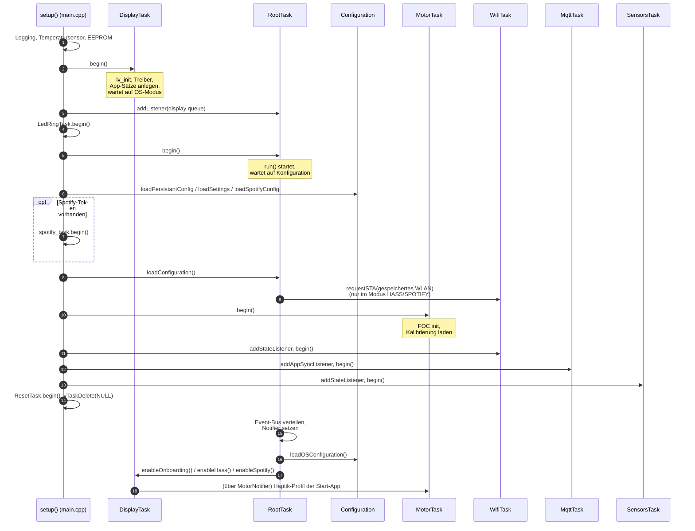
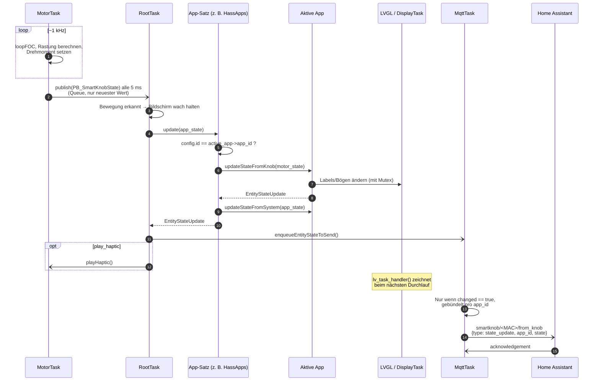
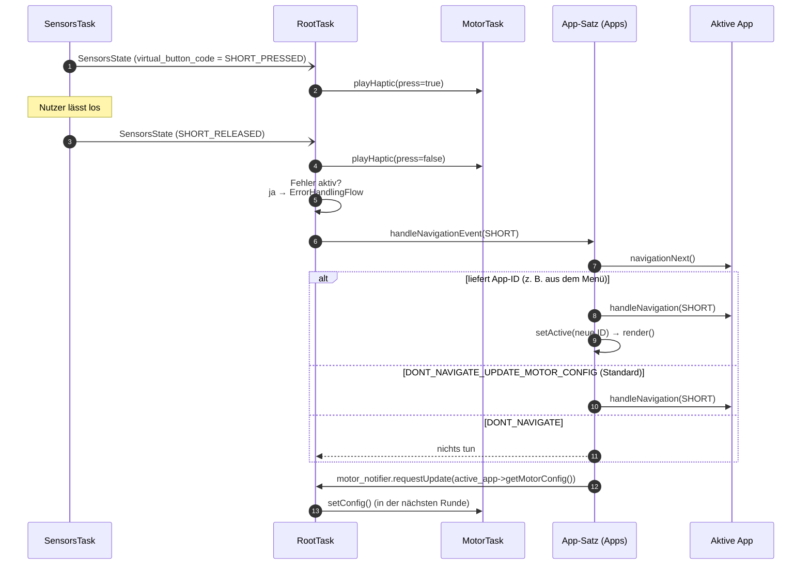
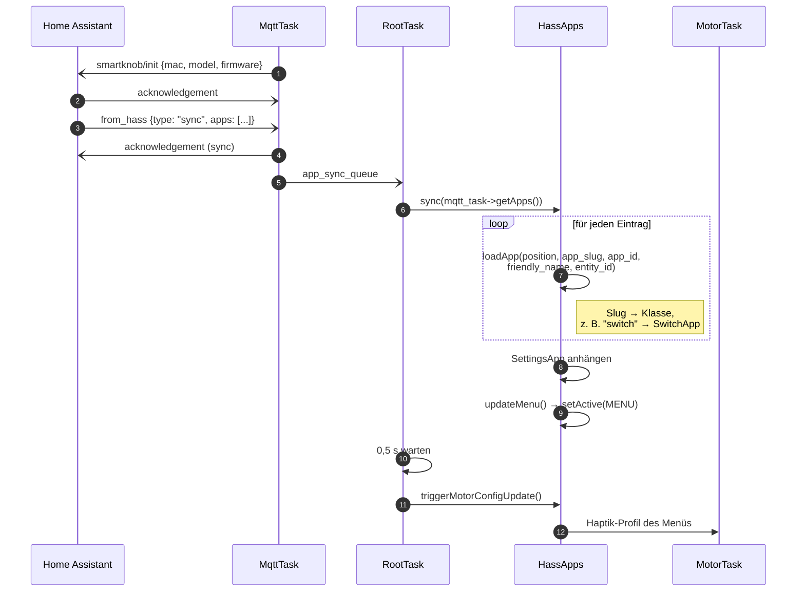
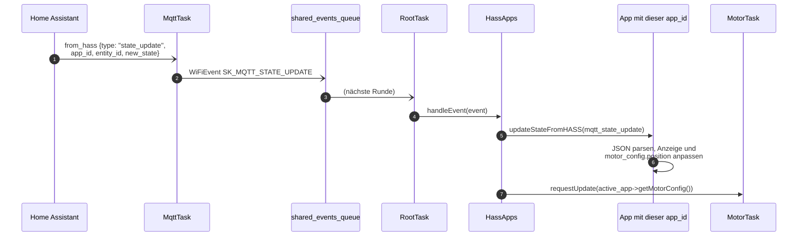
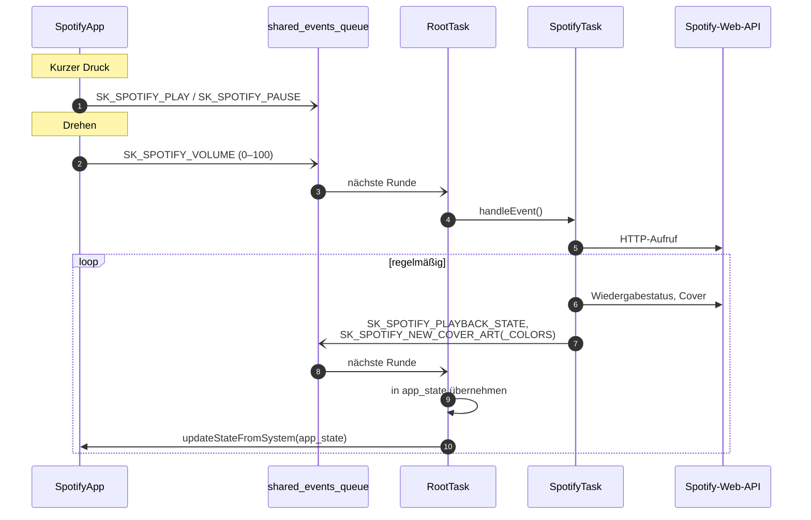
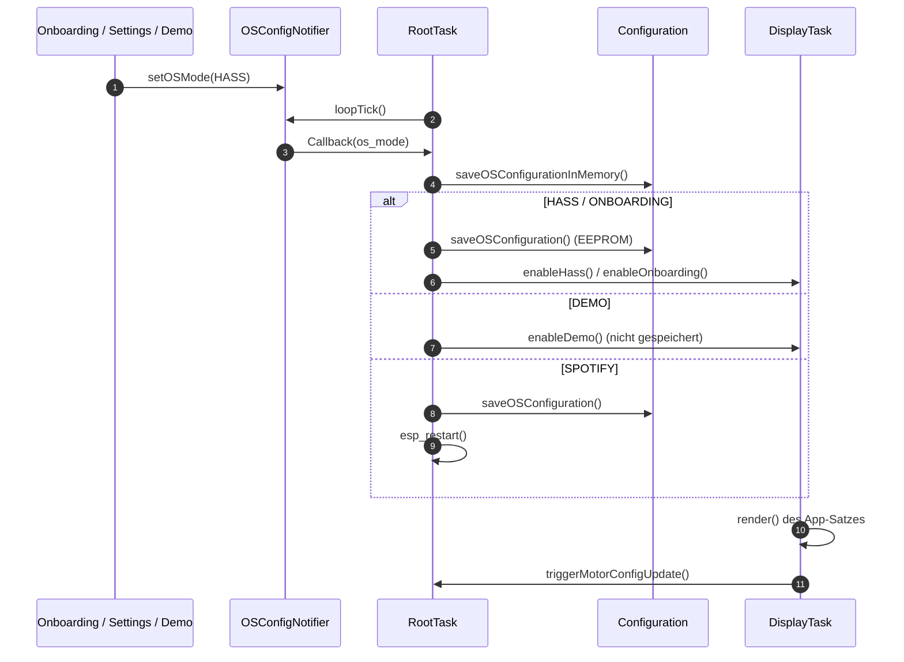

# 2. Abläufe: was passiert wann?

[← 1. Kern-Framework](01-kern-framework.md) · [Übersicht](../ARCHITEKTUR.md) · [3. Apps und UI →](03-apps-und-ui.md)

Diese Seite zeigt die wichtigsten Aufrufketten als Sequenzdiagramme. Funktionsnamen entsprechen dem Code, damit man direkt hineinspringen kann.

## 2.1 Systemstart

`setup()` in `main.cpp` startet die Tasks in dieser Reihenfolge und löscht sich am Ende selbst (`vTaskDelete(NULL)`). `loop()` ist leer.



Hinweis: Steht im EEPROM der Modus `DEMO`, startet die Firmware trotzdem im Onboarding (Demo wird nicht dauerhaft gespeichert).

## 2.2 Drehen am Knopf → Anzeige und Home Assistant

Das ist der häufigste Ablauf, etwa 200-mal pro Sekunde meldet der Motor seinen Zustand.



Wichtig für App-Entwickler: Die App bekommt nur dann Updates, wenn die `id` in der gerade aktiven Motor-Config gleich ihrer `app_id` ist. Direkt nach einem App-Wechsel kann es ein paar Millisekunden dauern, bis der Motor die neue Config übernommen hat. In dieser Zeit bekommt die neue App keine Updates. Das ist gewollt und verhindert, dass sie Positionswerte der vorherigen App sieht.

## 2.3 Drücken → Klick und Navigation



Ein **langer Druck** läuft genauso, nur mit `NavigationEvent::LONG` und `navigationBack()`. Standardmäßig liefert `navigationBack()` den Wert `MENU`, ein langer Druck führt also aus jeder App zurück ins Menü. Im Menü selbst bewirkt ein langer Druck je nach Modus etwas anderes (Demo: zurück ins Onboarding).

## 2.4 Home Assistant: Apps synchronisieren

Welche Apps im HASS-Modus erscheinen, bestimmt allein Home Assistant. Die Firmware hat keine feste App-Liste.



Ein Eintrag im `apps`-Array sieht so aus (siehe auch `demo_apps.cpp`):

```json
{
  "app_slug": "light_dimmer",
  "app_id": "light.workbench",
  "friendly_name": "Workbench",
  "entity_id": "light.workbench",
  "area": "Kitchen",
  "menu_color": "#ffffff"
}
```

`app_slug`, `app_id`, `entity_id` und `friendly_name` sind Pflicht, sonst wird der Eintrag übersprungen.

## 2.5 Home Assistant: Zustand ändert sich in HA



Damit springt bei einem Lichtschalter, der in HA umgeschaltet wurde, auch die physische Rastung auf die neue Position.

## 2.6 Spotify: Play/Pause und Lautstärke

Die Spotify-App kommuniziert nicht über MQTT, sondern direkt mit der SpotifyTask über den Event-Bus.



## 2.7 Betriebsmodus wechseln



## 2.8 Bildschirm wecken und dimmen

Die RootTask führt `screen_state.awake_until` und `has_been_engaged`:

- **Wecken**: Drehbewegung, Druck, Näherung < 200 mm, Fehler oder Kalibrierung setzen `awake_until` in die Zukunft (bei physischer Bedienung meist `settings.screen.timeout`, Standard 30 s; bei bloßer Annäherung `KNOB_ENGAGED_TIMEOUT_NONE_PHYSICAL` = 8 s, gesetzt in `platformio.ini`).
- **Wach**: volle Helligkeit (`max_bright`), Dehnungssensor an, LED-Ring auf voller Helligkeit.
- **Nach Ablauf**: Mit Lichtsensor (`SK_ALS`) wird die Helligkeit an die Umgebung angepasst (zwischen 0 und `min_bright`). Der LED-Ring geht auf gedimmt oder in den „Leuchtturm“-Modus mit einer LED. Der Dehnungssensor wird abgeschaltet.
