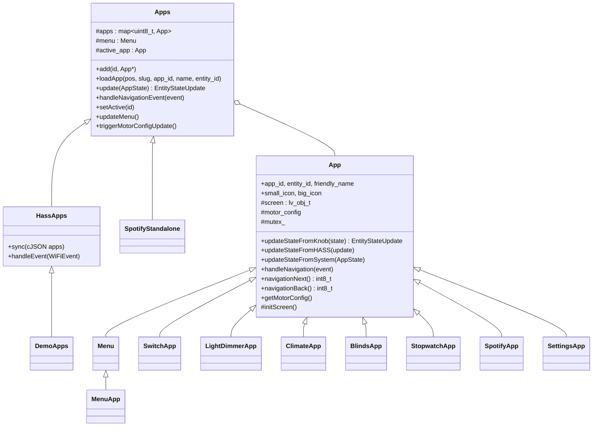

# 3. Apps und UI

[← 2. Abläufe](02-ablaeufe.md) · [Übersicht](../ARCHITEKTUR.md) · [4. Anleitung →](04-anleitung-app-hinzufuegen.md)

Alles auf dieser Seite ist „oberhalb“ des Kerns. Apps sehen die Welt nur über drei Dinge: den Knopfzustand (`PB_SmartKnobState`), den Systemzustand (`AppState`) und Navigation-Events. Sie wirken auf die Welt nur über ihr Haptik-Profil (`motor_config`), über `EntityStateUpdate` (an Home Assistant) und über Events auf dem Bus.

## 3.1 Betriebsmodi (`OSMode`)

Die Firmware ist immer in genau einem Modus. Jeder Modus hat einen eigenen „App-Satz“, den die DisplayTask beim Start anlegt.

| Modus | App-Satz (Klasse) | Datei | Inhalt |
|---|---|---|---|
| `ONBOARDING` | `OnboardingFlow` | `onboarding_flow/` | Willkommen, Einrichtung von HA, Spotify oder Demo |
| `DEMO` | `DemoApps` (erbt von `HassApps`) | `apps/demo_apps.cpp` | Feste App-Liste aus einem JSON im Code, ohne Netzwerk |
| `HASS` | `HassApps` (erbt von `Apps`) | `apps/hass_apps.cpp` | App-Liste kommt per MQTT von Home Assistant |
| `SPOTIFY` | `SpotifyStandalone` (erbt von `Apps`) | `apps/spotify_standalone.cpp` | Nur die Spotify-App, ohne Menü |
| (über allen) | `ErrorHandlingFlow` | `error_handling_flow/` | Fehlerbildschirme für WLAN/MQTT und Reset |

### Was ein Modus kostet

Ein neuer Modus braucht Änderungen im Kern: einen Wert in `OSMode` (`configuration.h`), einen Getter und eine `enableXxx()`-Methode in `DisplayTask`, und Einträge in allen `switch (mode)`-Blöcken der `RootTask` (Event-Verteilung, `update`, Navigation in `updateHardware`, Reset-Button, `SK_DISMISS_ERROR`). Meist reicht es stattdessen, eine neue **App** in einem bestehenden Modus anzubieten.

## 3.2 Der `Apps`-Container

`apps/apps.cpp` verwaltet eine Liste von Apps plus ein Menü:

- **`loadApp(position, slug, …)`** ist die **App-Fabrik**: Sie entscheidet anhand des Slugs, welche Klasse instanziiert wird. Das ist die einzige Stelle, die man für eine neue App erweitern muss.
- **`updateMenu()`** baut aus allen geladenen Apps das Menü (Icon und Name je App) und aktiviert es.
- **`update(app_state)`** leitet Knopf- und Systemzustand an die aktive App weiter, aber nur, wenn `motor_state.config.id == active_app->app_id`.
- **`handleNavigationEvent(event)`** fragt die aktive App per `navigationNext()` / `navigationBack()`, wohin es gehen soll, ruft `handleNavigation()` der App auf, wechselt ggf. die App und schickt danach das Haptik-Profil der (neuen) aktiven App an den Motor.
- **`setActive(id)`** schaltet um und ruft `render()` auf (lädt den LVGL-Screen der App).

### Navigations-Rückgabewerte (`SharedAppIds` in `app.h`)

| Rückgabe von `navigationNext()` / `navigationBack()` | Wirkung |
|---|---|
| eine App-Position ≥ 0 | Zu dieser App wechseln |
| `MENU` (-2) | Ins Menü wechseln |
| `DONT_NAVIGATE` (-1) | Gar nichts tun, auch `handleNavigation()` wird nicht aufgerufen |
| `DONT_NAVIGATE_UPDATE_MOTOR_CONFIG` (-3) | In der App bleiben, `handleNavigation()` aufrufen, danach Haptik-Profil neu an den Motor schicken |

Standard in `App`: `navigationNext()` = `DONT_NAVIGATE_UPDATE_MOTOR_CONFIG`, `navigationBack()` = `MENU`. Das Menü setzt `next_` auf die gerade gewählte App, deshalb öffnet ein kurzer Druck im Menü die App.

## 3.3 Die `App`-Basisklasse

`apps/app.h`. Jede App ist eine Unterklasse und hat:

| Element | Wozu |
|---|---|
| `screen` | Eigener LVGL-Screen (240×240, schwarz). Alles UI wird darauf aufgebaut. `render()` lädt ihn. |
| `mutex_` | Bildschirm-Mutex. **Jeder LVGL-Zugriff muss in `SemaphoreGuard lock(mutex_);` stehen**, weil die Methoden aus der RootTask laufen. |
| `app_id` | Eindeutige ID (bei HA meist die Entity-ID, z. B. `light.kitchen`). Wird für Routing von HA-Updates benutzt. |
| `entity_id`, `friendly_name` | HA-Entität und Anzeigename im Menü. |
| `big_icon`, `small_icon` | 80-px- und 40-px-Icon fürs Menü (`assets/images/80`, `/40`). |
| `motor_config` | Das Haptik-Profil der App (siehe [1.2](01-kern-framework.md#das-haptik-profil-pb_smartknobconfig)). **`motor_config.id` muss gleich `app_id` sein**, sonst bekommt die App keine Knopf-Updates. |
| `state_sent_from_hass` | Hilfsflag, um nach einem HA-Update das nächste Knopf-Update zu ignorieren (verhindert ein Echo zurück an HA). |
| `motor_notifier` | Zum Anfordern einer neuen Haptik von innen heraus (z. B. Seitenwechsel in einer App). |

Virtuelle Methoden, die Apps überschreiben:

| Methode | Wann aufgerufen | Typische Aufgabe |
|---|---|---|
| `initScreen()` | Selbst im Konstruktor aufrufen | LVGL-Objekte anlegen |
| `updateStateFromKnob(state)` | Bei jedem Motor-Update (~200/s), wenn die App aktiv ist | Position → Anzeige; bei Änderung `EntityStateUpdate` mit `changed = true` zurückgeben |
| `updateStateFromSystem(app_state)` | Direkt danach | WLAN-Status, Spotify-Daten, Uhrzeit usw. anzeigen |
| `updateStateFromHASS(update)` | Wenn HA einen neuen Zustand für diese `app_id` schickt (auch wenn die App nicht aktiv ist) | JSON parsen, Anzeige und `motor_config.position` anpassen |
| `handleNavigation(event)` | Bei kurzem/langem Druck (siehe 3.2) | App-interne Aktion, z. B. Seite wechseln, Play/Pause |
| `navigationNext()` / `navigationBack()` | Vor `handleNavigation` | Entscheiden, ob die App verlassen wird |

### Wichtige Muster in bestehenden Apps

- **Position merken**: Apps schreiben in `updateStateFromKnob` die aktuelle Position zurück in `motor_config.position` und `motor_config.position_nonce`. Kommt man aus dem Menü zurück in die App, steht der Knopf wieder an der alten Stelle.
- **Mehrere Seiten in einer App**: `LightDimmerApp` und `SettingsApp` nutzen `PageManager<Enum>` (`display/page_manager.h`). Jede Seite ist eine `BasePage` mit eigenem LVGL-Container, der ein-/ausgeblendet wird. Pro Seite kann die App eine andere `motor_config` setzen und mit `motor_notifier->requestUpdate()` anwenden.
- **Zustand an HA**: `EntityStateUpdate.state` muss **gültiges JSON** sein, es wird roh in die MQTT-Nachricht eingefügt. Beispiele: `{"on": true}` (Switch), `{"on": true, "brightness": 128, "rgb_color": [r, g, b]}` (Dimmer).
- **Ohne HA**: `StopwatchApp` sendet nichts an HA und überschreibt `navigationNext()`, um mit kurzem Druck Runden zu stoppen.

## 3.4 Vorhandene Apps

| Slug | Klasse | Ordner | Haptik | Sendet an HA |
|---|---|---|---|---|
| `switch`, `light_switch` | `SwitchApp` | `apps/switch/` | 2 Positionen, Snap-Point 0.55 | `{"on": bool}` |
| `light_dimmer` | `LightDimmerApp` | `apps/light_dimmer/` | Helligkeit 0–100 % in feinen Rastungen, Zusatzseiten für Farbton und Farbtemperatur | `on`, `brightness` (0–255), `rgb_color` oder `color_temp` |
| `climate` | `ClimateApp` | `apps/climate/` | Solltemperatur in Schritten, Modus per Druck | `mode`, `target_temp`, `current_temp` |
| `blinds` | `BlindsApp` | `apps/blinds/` | 21 Positionen (5-%-Schritte) | `position` (0–100) |
| `stopwatch` | `StopwatchApp` | `apps/stopwatch/` | Kurzer Druck = Start/Runde | nein |
| `spotify` | `SpotifyApp` | `apps/spotify/` | Lautstärke 0–100 | nein (direkt Spotify-API über Events) |
| (immer angehängt) | `SettingsApp` | `apps/settings/` | Seitenwahl | nein |
| (intern) | `MenuApp` | `apps/app_menu.cpp` | Endlos drehbar, 25° pro Eintrag | nein |

Die Slugs stehen als Konstanten in `apps/app.h` (`APP_SLUG_*`).

## 3.5 Flows: Onboarding und Fehler

`OnboardingFlow` und `ErrorHandlingFlow` sind **keine** `Apps`-Unterklassen, sondern eigene Klassen mit einem `PageManager`. Sie haben dieselbe Art von Schnittstelle (`render()`, `update()`, `handleNavigationEvent()`, `handleEvent()`, `triggerMotorConfigUpdate()`), sodass die RootTask sie genauso behandeln kann.

- Der **OnboardingFlow** reagiert auf WLAN-/MQTT-Events vom Bus (z. B. QR-Code anzeigen, wenn der Access Point läuft) und setzt am Ende per `OSConfigNotifier` den Modus.
- Der **ErrorHandlingFlow** übernimmt Bildschirm und Navigation, solange `getErrorType() != NO_ERROR`.

## 3.6 UI-Bausteine

- **LVGL 8.4**, Konfiguration in `display/lv_conf.h`. Display 240×240, rund.
- **Schriften** in `assets/fonts/` (AktivGrotesk, RobotoMono) als C-Arrays. Neue Schriften erzeugt man mit dem LVGL-Font-Converter (siehe `assets/fonts/lvgl_fonts.md`) und bindet sie mit `LV_FONT_DECLARE(name);` ein.
- **Icons** in `assets/images/40/` und `/80/`, Deklaration per `LV_IMG_DECLARE(x80_xxx);`. Viele Apps färben die weißen Icons per `lv_obj_set_style_img_recolor` ein.
- **Farben/Helfer** in `util.h` (z. B. `dark_arc_bg`).
- Die **Setup-Webseite** (WLAN/MQTT/Spotify im Browser) liegt kompiliert in `firmware/data/setup/`, Quellcode in `software/web-preact/`.
